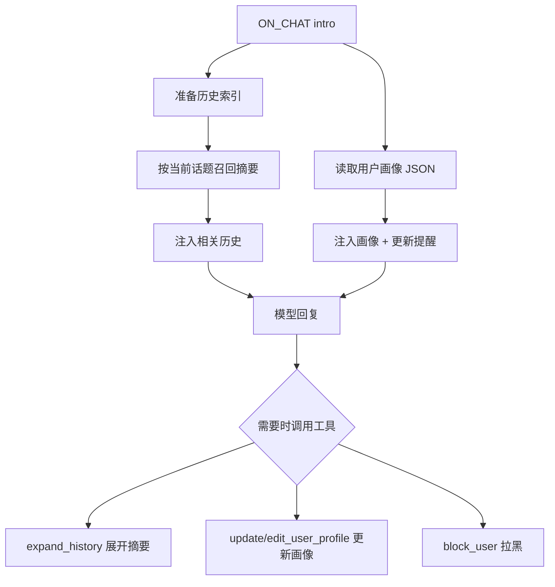

# clovers-agent-life-extensions

**给 [clovers-agent](https://pypi.org/project/clovers-agent/) 补上一层「长期记忆 + 用户画像」。**

> 当前版本 `0.3.0`（开发中），接口与数据格式可能调整；尚未发布到 PyPI。

`clovers-agent` 自带的是会话内的滑动窗口和超长时的摘要压缩。本插件在它之上做两件事：

- **长期记忆**：把压缩后的历史摘要建立索引，按关键词、语义和新鲜度混合召回，在需要时展开原文
- **用户画像**：按用户维护称呼、标签、偏好、印象和带星级的记忆，附带更新提醒、拉黑与两步式编辑

插件只通过 `AgentTools` 扩展，不修改 `clovers-agent` 的核心代码。

## 特性

- **混合召回**：BM25（关键词）+ 向量相似度 + 按序列排序的衰减，兼顾精确匹配和语义相近
- **关键词归一**：模糊匹配把「天气 / 天气预报 / 查天气」收敛到同一关键词，降低措辞差异
- **渐进披露**：先注入摘要列表，模型需要细节时再调用 `expand_history` 展开全文，节省上下文
- **增量索引**：已处理的摘要移入 `histories_processed/`，首次使用时构建索引，之后只增量更新
- **冷热分层**：超过上限的摘要每日移入 `histories_archived/YYYYMM/`，数据目录不会无限膨胀
- **用户画像**：结构化字段 + 星级记忆，支持新增、强化、弱化，达到容量后按星级保留高价值内容
- **更新提醒**：按「距上次更新多少轮」分级提醒，避免每轮都催模型改档案
- **与 clovers-agent 兼容**：直接读取 `histories/*.md` 的 front matter，不额外生成一份摘要
- **数据本地**：画像与索引都在 `clovers-agent` 的数据目录内，无需外部数据库

## 工作方式



1. `clovers-agent` 压缩上下文时，会把摘要写进会话目录的 `histories/<时间>.md`，front matter 包含 `overview`、`keywords`、`timestamp`
2. 插件在 `ON_CHAT` 场景被选中时读取这些摘要，构建/更新索引，并用当前 `message_history` 作为查询召回相关条目
3. 同时读取 `UserProfile/<user_id>.json`，拼成 Markdown 注入本轮上下文（`<system-reminder>`），并根据距上次更新的轮数追加提醒
4. 模型可以展开某条摘要、更新画像，或在需要时拉黑用户

## 安装

要求 Python **3.12+**，以及可用的 `clovers-agent`（`>=0.3.3`）。

```bash
pip install clovers-agent
pip install clovers-agent-life-extensions
```

尚未发布到 PyPI 时，从本仓库安装：

```bash
pip install -e .
```

安装后让 clovers 宿主加载 `clovers_agent_life_extensions` 插件（例如加入 `clovers-agent` 配置的 `plugins` 列表），无需修改宿主代码。

## 配置

配置由 `clovers_client.Config.sync_config("clovers_agent_life_extensions")` 托管，字段名即配置键。

### 用户画像

| 键                                     | 默认值 | 说明                                              |
| -------------------------------------- | ------ | ------------------------------------------------- |
| `user_profile.profile_memory_size`     | `30`   | 每个用户最多保留的记忆条数，超出后按星级衰减/淘汰 |
| `user_profile.reminder_cooldown_turns` | `4`    | 更新后的冷却轮数；不足该轮数时提示「无需更新」    |
| `user_profile.reminder_turns`          | `8`    | 超过该轮数时提示「确认档案是否过时」              |
| `user_profile.strong_reminder_turns`   | `16`   | 超过该轮数时提示「及时更新档案」                  |

### 长期记忆

| 键                                 | 默认值 | 说明                                                      |
| ---------------------------------- | ------ | --------------------------------------------------------- |
| `histories.keyword_fuzz_threshold` | `85`   | 关键词模糊匹配阈值（0-100，越大越严格）                   |
| `histories.recall_limit`           | `30`   | 单次最多召回多少条摘要                                    |
| `histories.max_memory_size`        | `120`  | `histories_processed/` 中保留的摘要上限，超出部分每日归档 |

## 数据目录

```text
{clovers_agent.path}/
├── UserProfile/
│   └── <user_id>.json                    # 用户画像
└── sessions/
    └── <session_id>/
        ├── histories/                    # clovers-agent 压缩出的摘要
        ├── histories_processed/          # 已加入索引的摘要
        ├── histories_unrecognized/       # front matter 不完整，无法解析
        └── histories_archived/
            └── YYYYMM/                   # 超出上限后的冷归档
```

- `{clovers_agent.path}` 来自 `clovers-agent` 的 `path` 配置，默认 `./data/CloversAgent/`
- `histories_unrecognized/` 只做隔离，不会自动删除；排查后可手动处理
- 归档文件不再参与召回，只作为冷数据保留；需要时可手动移回 `histories_processed/`

## 工具

| 工具                  | 参数                                                                                                       | 说明                                                                                  |
| --------------------- | ---------------------------------------------------------------------------------------------------------- | ------------------------------------------------------------------------------------- |
| `expand_history`      | `index`                                                                                                    | 展开当前召回列表中的第 `index` 条摘要；列表对应当前这一轮，下一轮请以新的召回结果为准 |
| `update_user_profile` | —                                                                                                          | 返回画像维护准则与 `edit_user_profile` 的参数说明，本身不写入                         |
| `edit_user_profile`   | `address_as`、`tags`、`preferences`、`impression`、`new_memories`、`promote_memories`、`demote_memory_ids` | 覆盖非空字段，并按 id 强化/弱化记忆；所有参数可选                                     |
| `block_user`          | `block_days`                                                                                               | 拉黑当前用户 1-30 天；到期自动失效                                                    |

典型流程是：模型先调用 `update_user_profile` 拿到当前画像的维护准则，再调用 `edit_user_profile` 落盘。写入成功后，该用户的更新计数会重置。

## 记忆检索

- 查询由当前会话的 `message_history` 拼成，包含最近的用户消息和助手回复
- 索引由「摘要关键词 + 摘要 overview 的句向量」组成，每个会话一份，保存在 `session.extra` 中
- 打分 = `0.5 × 归一化 BM25 + 0.5 × 余弦相似度`，再乘以按条目顺序的指数衰减（`2^(-i/30)`）
- 召回结果按分数降序，取前 `recall_limit` 条，并只保留不低于平均分的条目
- 摘要的 `keywords` 会先做小写化和去空白，再通过 rapidfuzz 归一化近义关键词
- 每日维护把 `histories_processed/` 中超过 `max_memory_size` 的最旧摘要移入归档

> 索引是进程内内存结构，重启后会在下一条消息时重建；归档摘要不参与检索。

## 用户画像

`UserProfile` 的结构：

| 字段          | 说明                                                   |
| ------------- | ------------------------------------------------------ |
| `nickname`    | 平台昵称，编辑时自动更新                               |
| `address_as`  | 助手对用户的称呼                                       |
| `tags`        | 核心特征关键词，逗号分隔                               |
| `preferences` | 话题偏好、语言风格、观点、禁忌等稳定倾向               |
| `impression`  | 一段整体性的人物印象                                   |
| `memories`    | 带 `id` / `content` / `star` 的用户记忆，`star` 取 0-5 |
| `block_until` | 拉黑截止时间戳，`0` 表示未拉黑                         |

记忆的维护规则：

- `new_memories` 新增记忆，初始 1 星
- `promote_memories` 按 id 强化，`star + 1`（上限 5），可用 `content` 合并更新内容
- `demote_memory_ids` 按 id 弱化，`star - 1`
- 达到 `profile_memory_size` 时按星级排序并淘汰低星记忆，最终按星级重新编号

提示词层面的约定写在 `user_profile/constants.py`：称呼、标签、偏好、印象都是简短概括；具体事件放用户记忆；相似记忆合并到靠前的条目。

## 隐私与安全

- 画像与历史摘要都是**明文 JSON/Markdown**，保存在宿主数据目录；请限制目录权限并避免提交到版本库
- 画像会再次进入本轮上下文，属于可被用户间接影响的内容；不要在画像中存放密钥、令牌等敏感信息
- `block_user` 当前是普通工具，模型可以调用；生产环境建议改为管理员命令或加二次确认
- 拉黑检查目前只在 `ON_CHAT` 场景执行；任务场景（如 `on_task`）不会读取画像，也不会被拉黑拦截
- `skill` / 插件代码在宿主进程内执行，权限与宿主相同

## License

MIT，见 [LICENSE](LICENSE)。
